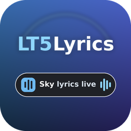
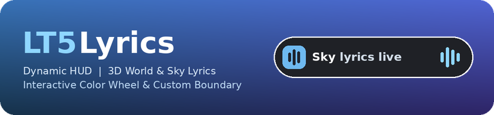
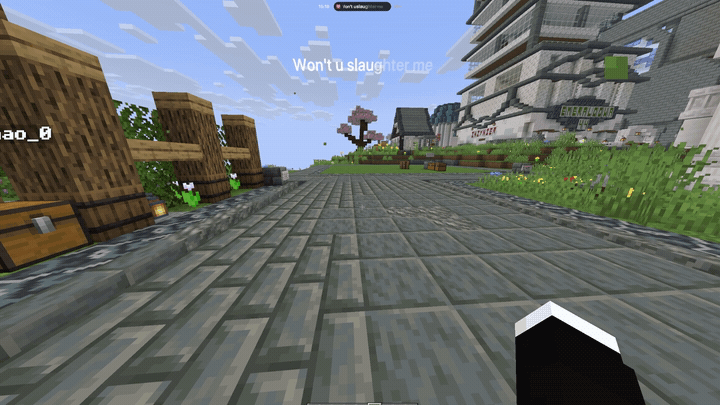
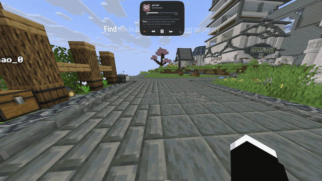
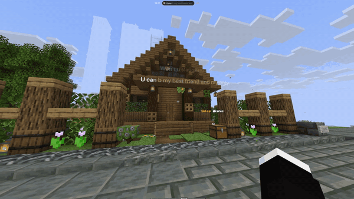
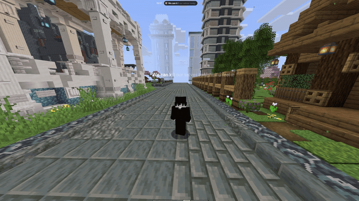

<div align="center">



# LT5Lyrics

**Your music. Your world. Every lyric.**

A client-side Fabric mod that brings your music into Minecraft with a music island,
synchronized karaoke, and World & Sky lyrics.

**1.11.7 · Minecraft 26.3 · Fabric · Java 25**

[Getting started](#getting-started) · [User guide](USER_GUIDE.md) · [Build from source](#build-from-source) · [Discord](https://discord.gg/3kqxEwDpXm)



</div>

---

## Music that belongs in your world

| Feature | What you get |
| --- | --- |
| **Music Island** | A compact HUD with track information, playback controls, and expandable settings. |
| **Synchronized lyrics** | Karaoke highlighting with word timing when available, plus local LRC support. |
| **World & Sky lyrics** | Visual-only 3D lyrics in your world or a distant sky display, without intercepting gameplay input. |
| **Customization Studio** | Simple presets for quick setup and Advanced controls for detailed tuning. |
| **Player selection** | Automatic lyrics-first selection between active Windows media sessions, or manual selection. |
| **Timing tools** | Quick temporary offsets, saved per-song adjustments, and selected-line tap sync. |

### See it in action

<details>
<summary><strong>Music Island & positioning</strong></summary>





</details>

<details>
<summary><strong>3D lyrics</strong></summary>





</details>

## Getting started

> **Platform note:** Desktop player detection and playback control currently use
> Windows SMTC. The macOS/Linux media backend is not implemented. Some browser
> tabs or players may not expose a usable media session.

1. Install **Minecraft: Java Edition 26.3** with **Fabric Loader 0.20.1 or later compatible version** and **Java 25**.
2. Install [Fabric API for Minecraft 26.3](https://modrinth.com/mod/fabric-api/versions?g=26.3&l=fabric). This source targets **0.165.0+26.3**.
3. Put the compiled `lt5lyrics-1.11.7+mc26.3.jar` and Fabric API in your Minecraft `mods` folder. On Windows, this is usually `%APPDATA%\.minecraft\mods`. Remove older LT5Lyrics JARs first.
4. Start music in Spotify or a browser exposing a supported Windows media session, join a world, and press **U** to open Studio.

**This repository contains source code.** Build the mod below if you do not already
have a compiled JAR. A source ZIP or `-sources.jar` is not an installable mod.

### Everyday controls

| Key | Action |
| --- | --- |
| **U** | Open Customization Studio |
| **J** | Toggle Sky Lyrics |
| **K** | Play / pause |
| **[ / ]** | Previous / next track |
| **Backslash (`\`)** | Toggle the top HUD |
| **T**, then click the island | Expand music controls and the community card |

Upgrading from an older version? Minecraft may retain your previous **O** binding.
Change **LT5Lyrics → Open Settings** in Options → Controls → Key Binds.

## What's new in 1.11.7

Clicking the music island in chat now automatically reveals the animated community
card. It adapts to available screen space and closes when chat, the expanded island,
or the HUD closes. Existing music controls, lyric timing, and the Share picture remain unchanged.

See the [full user guide](USER_GUIDE.md) for earlier changes, provider comparisons,
World/Sky settings, and troubleshooting details.

## Build from source

Install **JDK 25** and run these commands from the repository root:

```sh
# Linux / macOS
./gradlew build
```

```powershell
# Windows PowerShell
.\gradlew.bat build
```

Windows users can also double-click `BUILD_MOD.bat`.
The first build requires internet access to download Gradle and Minecraft/Fabric dependencies.

**Installable output:** `build/libs/lt5lyrics-1.11.7+mc26.3.jar`

### Checks

```sh
./gradlew checkBtp
```

The regular build includes the headless checks. Optional live-provider probes are
available as `probeLyricsSources`, `probeWordSync`, and `probeCommunitySources`;
they require network access and are not part of the regular build.

The [build workflow](.github/workflows/build.yml) builds on GitHub Actions and uploads
JAR artifacts. See [verification notes](VERIFICATION.md) for historical test coverage
and limitations; a successful build is not a real-player synchronization test.

## Privacy & provider limitations

- Enabled lyric providers receive song artist/title and duration when available. Coverage, timing accuracy, and availability vary.
- Personal provider keys are optional and stored **in plain text** in `.minecraft/config/lt5lyrics/settings.json`. Never publish that file.
- The inherited KuGou search endpoint uses HTTP, which can expose search terms on the network.
- The mod does not log in to music services or bypass their restrictions. Lyrics and third-party databases have their own rights and attribution terms.

Read the [provider documentation](USER_GUIDE.md#lyrics-sources-and-credentials) before adding keys or changing sources.

## Documentation

- [User guide & release history](USER_GUIDE.md)
- [Verification & known limitations](VERIFICATION.md)
- [Porting notes](PORTING-NOTES.md)
- [Settings design](SETTINGS_DESIGN.md)
- [Community panel integration](COMMUNITY-PANEL-INTEGRATION.md)

## Credits & license

**Made by VoxelZero · Vibe-coded with AI**

[Join the community on Discord](https://discord.gg/3kqxEwDpXm)

Licensed under [AGPL-3.0](LICENSE), with the attribution, additional terms, and
AI-training statement supplied in [NOTICE-VoxelZero.txt](NOTICE-VoxelZero.txt).
Original authors and third-party notices are preserved.

Uses [MediaPlayerInfo](https://github.com/Redstonecrafter0/MediaPlayerInfo),
[JNA](https://github.com/java-native-access/jna), SnakeYAML, and bundled fonts;
see the [user guide's license section](USER_GUIDE.md#license) and bundled notices.

## Native binaries & release transparency

**Made by VoxelZero.** See [NATIVES.md](NATIVES.md) for the native-file inventory,
verified JNA origins, and the **still-unresolved MediaPlayerInfo DLL provenance**
for Minecraft 1.21.11 and 26.2. [Release instructions](docs/RELEASING.md) describe
the version-specific sources, JDKs, proposed tags, and automated draft releases.
Third-party binaries retain their original licenses and credits.

Original LT5Lyrics / Song Island credit is preserved. Its exact upstream project
URL still needs to be supplied by the maintainer; no guessed original-project link
is presented here. Existing MediaPlayerInfo and other dependency credits remain above.
